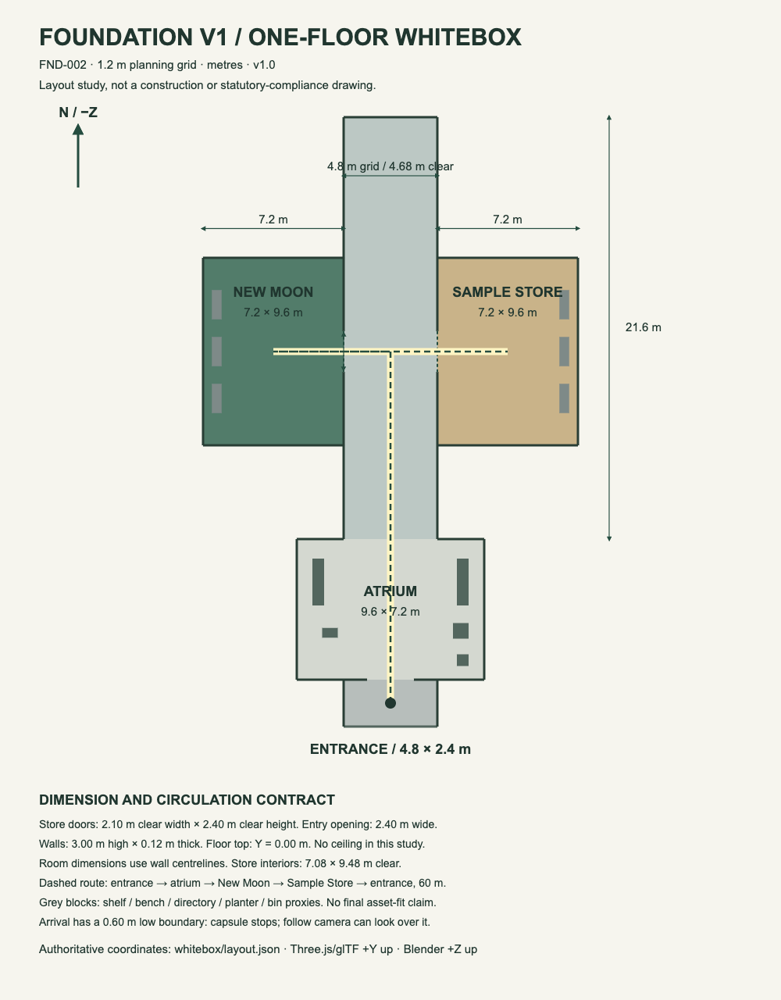

# Foundation v1 — FND-001 / FND-002 delivery

Recorded 2026-11-15, Asia/Singapore. **FND-001 baseline capture and FND-002 local whitebox are verified within the boundaries below.** This is a local design candidate; the public Mall and Gallery entry points were not changed. FND-003 is now verified in the separate [module-fit delivery](module-fit/README.md); FND-004 through FND-011 remain open in the [scope checklist](../../virtual-mall-foundation-v1-scope.md).

The [delivery receipt](reports/delivery.json) binds five verification reports and seven candidate files by SHA-256.

The owner explicitly requested no iPhone/Android hardware tests. Desktop Chromium plus viewport/touch emulation is the accepted environment for this delivery and Foundation v1. No physical-device compatibility or frame-rate guarantee follows from these results.

## Baseline and candidate identity

| Item | Identity |
| --- | --- |
| Runtime repository | `yapweijun1996/Webpage-Design-Gallery` |
| Pinned baseline | [`d636ce0f658c7fb2df7342648ed44b5d45012dfe`](https://github.com/yapweijun1996/Webpage-Design-Gallery/tree/d636ce0f658c7fb2df7342648ed44b5d45012dfe/demos/corporate/gjh/v11) |
| Application version | 1.1.30 |
| Original public entry | [GJH v11](https://yapweijun1996.github.io/Webpage-Design-Gallery/demos/corporate/gjh/v11/) |
| Matching successful deployment | [Pages workflow 43611657406](https://github.com/yapweijun1996/Webpage-Design-Gallery/actions/runs/43611657406) |
| Candidate entry | [whitebox/index.html](whitebox/index.html), served over local HTTP |
| Candidate geometry contract | [layout.json](whitebox/layout.json), v1.0; [export/build hashes](reports/geometry-build.json) |
| Candidate engine | Three.js r170, Rapier 0.21.0; unchanged baseline player/character modules |
| Browser | Chromium 156.0.8078.4 on macOS with SwiftShader; emulated touch through CDP |
| Asset tool | Blender 5.1.2, separate background process |

[Baseline identity evidence](reports/baseline-identity.json) verifies all 16 copied runtime files against the pinned source and samples four live files (`index.html`, `script.js`, `player.js`, `modes.js`). All four matched at the recorded time. This is not a claim that every live asset was hashed. The [runtime manifest](whitebox/runtime/source-manifest.json) lists exact file identities; bundled vendor licenses and the original visitor/cart provenance receipts are retained.

The existing v11 has three branded stores around a courtyard. The new opposite-side corridor and neutral Sample Store therefore require a separate candidate. The candidate uses the exported Blender GLB for visible geometry and `layout.json` for static Rapier colliders; it does not replace the baseline world or product configuration.

## Dimensioned layout



| Region | Planning dimensions | Coordinates: X / Z, metres |
| --- | --- | --- |
| Entrance apron | 4.8 × 2.4 m | −2.4…2.4 / 16.8…19.2 |
| Atrium | 9.6 × 7.2 m | −4.8…4.8 / 9.6…16.8 |
| Main corridor | 4.8 × 21.6 m | −2.4…2.4 / −12…9.6 |
| New Moon, west | 7.2 × 9.6 m | −9.6…−2.4 / −4.8…4.8 |
| Sample Store, east | 7.2 × 9.6 m | 2.4…9.6 / −4.8…4.8 |

The 1.2 m grid uses metres, +Y up and north −Z. Blender maps `(x,y,z)` to `(x,−z,y)` with +Z up. Floor top is Y=0. Walls are 0.12 m thick and 3.0 m high; dimensions above use wall centrelines, giving a 4.68 m clear corridor and 7.08 × 9.48 m clear shop interiors. The whitebox shop openings are 2.10 m wide and 2.40 m high; the entry opening is 2.40 m wide. Headers reserve the 2.40–3.00 m band. No ceiling or final material/lighting acceptance is included.

Six shelf proxies, two bench proxies and one directory, planter and bin proxy reserve placement space outside the central route. The entrance's 0.60 m low rear boundary stops the visitor capsule while leaving the existing follow camera unobstructed. A full-height rear wall was rejected after an actual screenshot showed the camera pressed into the avatar; the revised boundary and camera distance are checked in the final browser test.

The continuous route is entrance → atrium → corridor → New Moon → corridor → Sample Store → corridor → atrium → entrance, approximately 60 m. Only initial/reset placement sets the body transform; route verification drives the original controller through fixed physics steps, including both door openings, without teleporting between waypoints.

## Deliverables and verification

- [Editable Blender source](whitebox/foundation-v1.blend), [GLB](whitebox/foundation-v1.glb), [vector floor plan](whitebox/floor-plan.svg) and [Blender overview](whitebox/overview.png).
- [Whitebox browser report](reports/whitebox-browser.json): 1440×900 keyboard and 768×1024, 390×844, 320×568 emulated touch. All traverse both shops and return; east/west corridor walls and the arrival boundary stop the capsule. Actual keyboard/touch events move the visitor. Arrival follow-camera clearance, grounded placement and overflow checks pass. Screenshots cover arrival, corridor and plan view. Recorded draw-call samples are 66–74, below the inherited 200-call cap; they are not a worst-view performance survey.
- [GLB/export validation](reports/artifact-validation.json): Khronos validator, zero errors/warnings; all 43 GLB part centres and dimensions agree with the layout within 0.00001 m. File hashes match the build and runtime manifests. The GLB contains 516 triangles.
- [Saved-source check](reports/blender-source.json): a fresh Blender process reopens the shipped `.blend` and verifies all 43 editable mesh objects and metre-scale coordinate mapping. The current interactive Blender scene was not modified.
- [Baseline browser capture](reports/baseline-browser.json): fresh browser contexts at the same four viewport sizes, arrival and four-product directory; desktop map-assisted New Moon entry/return with real keyboard input, all four SKU previews and Demo Bag add/clear, plus a no-JavaScript directory. Known findings are retained separately from successful scenarios.

### Baseline finding BASE-001

On desktop, choosing **Start exploring** closes the map. Both the header Map button and the map's details summary are hidden at that size, leaving no direct map toggle. Source: `assets/ui.js` guide start/close behavior and `style.css` desktop map-summary rules. The baseline screenshot and browser report reproduce this state.

The recorded working path is **How to explore → Show quick guide → Choose a store**, then the New Moon destination and keyboard movement through the door. This workaround does not count as a fix. Address map discoverability in FND-006 when integrating the layout; the baseline capture is `PASS_WITH_FINDINGS`, not a clean release acceptance.

### Measurement protocol

Current reports retain one fresh-context navigation-to-ready sample per viewport and sampled draw calls; desktop product preview times include the load-button action through the visible 3D-ready state. Local HTTP, OS/GPU caches, software rendering and simultaneous machine load can affect results. These samples identify a reproducible baseline, not internet delivery latency or physical-phone performance.

For FND-010, pin the same code/layout/assets/quality and browser version, use five fresh-context runs per viewport, and report median/p95 readiness and preview time. Record transferred bytes and frame intervals over fixed 10-second stationary views at entrance and the selected busiest store; report frame-time median/p95, draw calls and memory only where telemetry is available. Keep the 200-draw-call cap. Additional latency/frame/memory thresholds require measurements of the integrated candidate; they are not invented from this sparse whitebox.

## Handoff to FND-003 / FND-004

1. **Historical handoff, resolved by the separate [FND-003 delivery](module-fit/README.md).** The existing [Mall Shopfront Door](../../../models/mall-shopfront-door/README.md) is 2.10 × 2.40 m overall, with a 1.94 × 2.32 m frame aperture and 1.734 m measured open clearance including hardware. The whitebox's unobstructed 2.10 m opening does not prove those installed dimensions or hinge sweeps. Confirm opening/frame allocation and colliders before replacing the proxy; do not scale the asset arbitrarily.
2. Inspect the already-created [fascia/collar candidates](../../../models/mall-fit-finishes/README.md) first. Their 0.60 m fascia band aligns with the study's 2.40–3.00 m reserve. Actual module seams, ceiling grid, corners, column placement, door sweep and camera clearance still need integrated checks. Do not author duplicate trim merely because this study uses boxes.
3. Sample Store is a labeled room and shelf volume only. FND-004 must provide neutral replaceable sign/product data and demonstrate the original demo product without brand leakage. The four New Moon product flows remain in the pinned baseline, not in the whitebox.
4. Lighting, actual public-facility models, product picking, menus, cart/seating interactions and failure/lifecycle acceptance retain their later scope owners. BASE-001 belongs to FND-006.

## Reproduce locally

From the repository root, with locked Node dependencies installed and the pinned baseline in a separate checkout:

```sh
python3 -m http.server 4178 --bind 127.0.0.1
# Open http://127.0.0.1:4178/docs/verification/foundation-v1/whitebox/
```

```sh
python3 docs/verification/foundation-v1/make-layout.py
/Applications/Blender.app/Contents/MacOS/Blender --background --python-exit-code 1 --python docs/verification/foundation-v1/generate-whitebox.py
/Applications/Blender.app/Contents/MacOS/Blender --background docs/verification/foundation-v1/whitebox/foundation-v1.blend --python-exit-code 1 --python docs/verification/foundation-v1/check-blender.py
node docs/verification/foundation-v1/check-artifacts.mjs
node docs/verification/foundation-v1/check-whitebox.mjs
MALL_BASELINE_DIR=/path/to/pinned-checkout node docs/verification/foundation-v1/check-baseline.mjs
MALL_BASELINE_DIR=/path/to/pinned-checkout node docs/verification/foundation-v1/check-baseline-identity.mjs
```

The generator replaces only this study's source/export/overview/plan. Back up manual edits before regenerating. A changed layout requires regeneration and the same export/source/browser checks. No Gallery registration, commit, push, deployment, or production Mall migration is included in this delivery.

Reusable knowledge remains project-local: preserve a hash-pinned target controller, verify the actual exported geometry, and inspect camera behavior separately from capsule collision. No global skill or external memory was changed.
