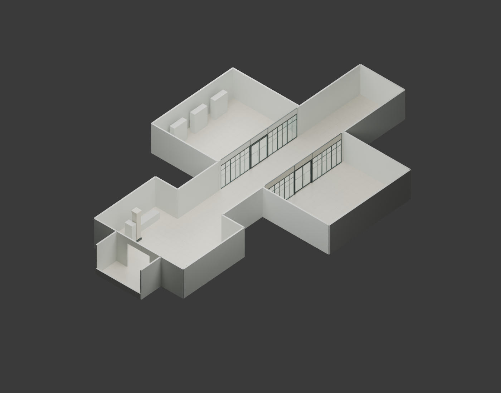

# FND-003 — Foundation module interfaces and door clearance

2026-11-15 · Asia/Singapore. **FND-003 verified locally.** Fitted candidate, version `1.1-module-fit`. Geometry, saved-source and browser receipts identify the verified artifact; this is not a production Mall release. The parent [FND-001/002 whitebox](../README.md) and its verification files remain unchanged.

The [delivery receipt](reports/delivery.json) binds all local candidate files and seven successful checks by SHA-256.

## Result and engineering decisions

The approved footprint is retained: 9.6 × 7.2 m atrium, 4.8 × 21.6 m corridor and two opposing 7.2 × 9.6 m shops. This assembly replaces the floor, ceiling, storefront and column-interface proxies with actual library exports, using metres and unit object scales.



- [Walkable local candidate](http://127.0.0.1:4178/docs/verification/foundation-v1/module-fit/) · [editable assembly](foundation-fitted.blend) · [assembled GLB](foundation-fitted.glb).
- [New 3.48 m fascia source](sources/fascia-run-348.blend) and [standalone GLB](exports/fascia-run-348.glb); six editable components, including an independent replaceable sign face.
- [Column/collar closeup](collar-junction.png) and [door/run-fascia closeup](fascia-junction.png), rendered from the saved assembly with a temporary inspection light; the source remains unchanged.
- [Placement, elevations and input hashes](layout.json), [build receipt](reports/build.json), [geometry/sweep report](reports/geometry.json), [frame measurements](reports/clearance.json), [source/surface proof](reports/source-surfaces.json), [adapter-source check](reports/adapter-source.json), [browser report](reports/browser.json).

### Installed door dimensions

| Measurement | Actual result | Meaning |
| --- | --- | --- |
| Overall frame | 2.100 × 2.400 m | Allocation in the facade; not usable passage width |
| Jamb-to-jamb frame aperture | 1.940 × 2.320 m | Actual fixed-frame vertex extents, measured in each door root |
| Both leaves at 90° | 1.734 m clear width | Projection includes moving leaves, pull handles and brackets |
| Both shops opening simultaneously | Minimum central gap 2.832 m | Across the 4.8 m corridor, at the sampled door poses |

The whitebox's 2.10 m unobstructed hole was a placeholder. It is now recorded as the **rough opening**, with the installed widths above; the asset is not enlarged to hide the difference. The actual walking controller has a 0.30 m capsule radius and 0.025 m skin. Browser checks verify the centre route, an offset passage and a blocked approach, rather than inferring passage from the nominal frame size.

The inspection candidate exposes open/closed endpoints. A 1° sampled sweep rejects an endpoint change if the real visitor capsule occupies a moving leaf's swept space. This is an instantaneous inspection-state change, not a new animated/automatic door system. Closed-door colliders prevent entry; opening the doors enables the same route.

### Interface resolution

| Interface | Applied contract and evidence |
| --- | --- |
| Floor | 224 existing 1.20 m modules; bottom Y=−0.03 m, finished top Y=0.00 m. All 402 adjacent module boundaries checked. The source tile's 1 mm grout recess remains intentional |
| Ceiling | 223 intact 1.20 m cassettes; grid underside Y=3.00 m. The cell above the column is omitted and replaced by its collar, rather than stacking an intact cassette with trim |
| Long glazed runs | Four runs, each three bays at 1.14 m connector pitch; remove the incoming left post at each shared joint. Twelve bays retain 16 posts instead of 24. Eight connector joints have no positive component-box overlap |
| Upper infill | Existing 2.10 × 0.60 m door fascia plus four new 3.48 × 0.60 m fascia runs, from Y=2.40 to 3.00 m. Each run covers `1.20 + 1.14 + 1.14 m` exactly |
| Fascia adaptation | Adapt the saved 1.20 m fascia source by extending rail/infill/sign ends and moving the side rails. Retain the 30 mm rail sections, 60 mm total depth and original materials. Unit object scales are verified; overlapping repeated 1.20 m fascias are not used |
| Facade ends | A 9.06 m assembled facade plus two 0.21 m study-shell returns meets the room's 9.48 m internal length. Returns touch the original transverse wall faces; they are scene geometry, not a newly registered library asset |
| Column/collar | Existing 0.60 m column and 1.20 m collar at X=−3.0, Z=13.8. Collar underside Y=3.00 m, 0.60 m central hole. It is outside the centre route and checked against surrounding components |
| Sign interface | Separate editable sign faces survive source save/reopen/re-export. Brand/product content remains FND-004; this work adds no new logo, SKU or product behavior |

Surface checks fire 13,166 rays through the fascia band and 2,700 through the collar ring, with no unresolved misses. Nine collar-hole probes remain unobstructed by the collar. New fascia/collar component boxes have no positive overlaps above 0.00001 m. Ceiling-grid probes preserve the existing 0–8 mm recess. Original misses at exact two-axis cell boundaries are retained in the report, along with four neighbouring 10-micrometre probes; they are not relabeled as successful original rays.

Floor perimeter modules end on the frozen wall centrelines; the inner 0.06 m of each wall covers the tile edge. The arrival boundary and enclosing walls stop the capsule before the outer edge. No new floor-edge adapter is required for this footprint; structural support or exterior flashing is not inferred from this visual assembly.

## Verification and preserved behavior

The exported assembly contains 469 library instances and 536,728 triangles. Both the complete assembly and new fascia GLB pass Khronos validation with zero errors and warnings. All exported instance bounds match the Blender placement receipt. Original input exports and the original 1.20 m fascia source keep their hashes; the prior delivery's seven candidate files and five reports still match their recorded hashes.

The existing door-sweep checker is reused, with a recorded checker hash: each door is sampled at 273 poses (left-only, right-only, both; 0–90° in 1° steps), plus 91 simultaneous two-door poses. It finds no fixed-component or opposite-leaf collisions and no moving vertices outside the tiled floor union. These are component OBB and discrete-pose checks, not continuous-time collision or building certification.

The saved assembly is reopened in a fresh Blender process. An isolated copy's actual sign vertices are raised 4 mm, its roughness changed to 0.37, then saved, reopened, exported and imported again. Geometry and material changes survive; the canonical source hash stays unchanged. The standalone 3.48 m fascia source is separately reopened, with all six components, original sections and unit scales verified.

The browser uses the parent delivery's hash-pinned Three.js r170, Rapier 0.21.0 and unchanged v11 visitor/controller modules. It loads the actual assembly bytes and reports their SHA-256 before parsing. Static shell/floor colliders retain the frozen footprint. Door and partition colliders derive from actual mesh bounds; moving door meshes retain their hierarchy.

Static opaque geometry batches by material. Static glazing batches only within a single coplanar facade run, with front and back visibility bands kept in separate sorting layers. Moving doors remain independent. This reduces the observed entrance draw calls from 322 to 154 without changing exported geometry, material opacity or sidedness. The browser check enforces the inherited 200-call cap at every route checkpoint and in the plan view; the exact per-view samples are retained in its report.

Browser scenarios cover 1440×900, 768×1024, 390×844, 320×568 and 667×375: entrance → both shops → entrance without teleporting between route waypoints; closed-door blocking; rejected closing with an occupied sweep; actual keyboard or CDP touch movement; grounded placement; no horizontal overflow. Desktop also probes both doors at actual starting offsets of 0.50, 0.70 and 1.30 m. The 0.50 m approach passes; a 0.70 m approach slides to about 0.54 m before passing; the fixed glazing blocks 1.30 m approaches. Analog input slows near the probe target so placement error stays below 5 mm; no body teleport is used. Screenshots in `screenshots/` capture arrival, both shop interiors, occupied doorway and plan view.

Final browser receipts record Chromium and ANGLE Metal on Apple M4. Earlier SwiftShader attempts timed out during loading/capture of this larger scene; no successful software-renderer acceptance is claimed. Draw calls do not establish frame rate, memory headroom or network performance. The owner's iPhone/Android hardware-test waiver remains in effect.

## Scope and next owners

- FND-004 still owns actual neutral-shop configuration and product/sign content. Shelf/public-fixture blocks remain reservations for later dressing.
- FND-006 still owns baseline finding BASE-001, overlay/input transitions and final automatic-door interaction policy. This local preview does not patch the production v11 map.
- FND-010 owns integrated performance, failure/lifecycle and release acceptance. The larger scene needs those measurements even though the sampled draw-call cap passes.
- Cart integration remains deferred. The pinned v11 cart controller uses a conservative 1.40 m-radius pushing shape (2.80 m diameter), so this walking-only door acceptance does not establish cart passage through 1.734 m. Review that controller footprint in the later cart integration task.
- Original asset licenses and owner-project reuse terms continue to apply. No new third-party artwork is included; no public redistribution permission, Gallery registration, commit, push or deployment is asserted.

## Reproduce

Use Blender 5.1.2 and the repository's locked Node dependencies. Review the scripts first. The generator writes only this candidate directory and replaces the local adapter/assembly outputs; back up manual edits before regeneration.

```sh
/Applications/Blender.app/Contents/MacOS/Blender --background --threads 4 --python-exit-code 1 --python docs/verification/foundation-v1/module-fit/assemble.py
node docs/verification/foundation-v1/module-fit/check-geometry.mjs
node docs/verification/foundation-v1/module-fit/check-clearance.mjs
/Applications/Blender.app/Contents/MacOS/Blender --background --threads 4 --python-exit-code 1 --python docs/verification/foundation-v1/module-fit/check-source.py
/Applications/Blender.app/Contents/MacOS/Blender --background --threads 2 --python-exit-code 1 --python docs/verification/foundation-v1/module-fit/check-adapter.py
node docs/verification/foundation-v1/module-fit/check-browser.mjs
/Applications/Blender.app/Contents/MacOS/Blender --background --threads 4 --python-exit-code 1 --python docs/verification/foundation-v1/module-fit/render-joints.py
node docs/verification/foundation-v1/module-fit/seal.mjs
python3 -m http.server 4178 --bind 127.0.0.1
```

The browser checker defaults to Metal on macOS and SwiftShader elsewhere; `FND_BROWSER_GPU` selects the backend explicitly. Do not carry a PASS to an untested backend or changed geometry. The current parent whitebox remains separately accessible at `/docs/verification/foundation-v1/whitebox/`.

Engineering workflow: `kb-mcp:coding-skills` routed this change to `coding:safe-impact-regression-gate`. KB retrieval supplied no applicable project implementation; existing checked-in corridor/fit studies were adapted only after current source and artifact review. Verification lessons remain in this project record; no global memory was changed.
