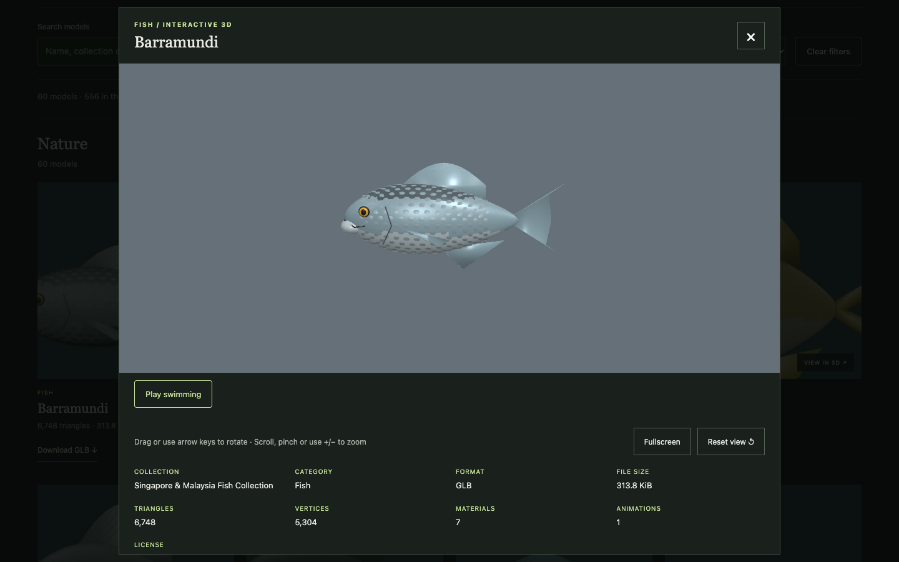
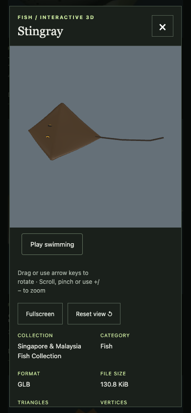
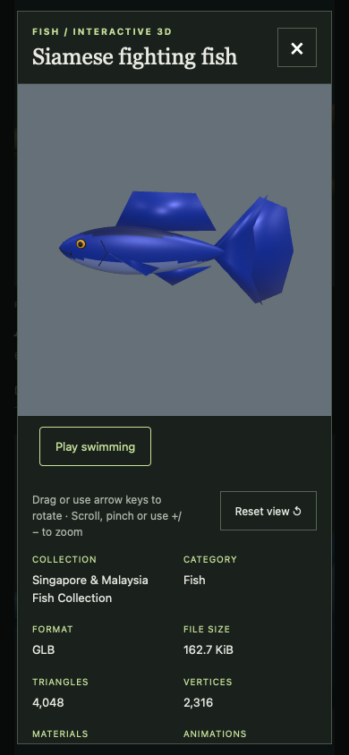

# Final production verification screenshots

These screenshots belong to the passing 180-case production run completed on 2026-11-15 at 03:43:47 Singapore time. Build: `52794dce31c58652`; deployment commit: `2bf3f96100ad59043b9072fdc68341824e3ec283`.

The five representative fish below have a full viewer capture and two different paused swimming poses in each of the three browser profiles. The JSON report contains assertions for all 60 species per profile. Screenshots are representative evidence; the full 180-case result is in [animation-results.json](animation-results.json).

| Profile | Fish | Viewer | Pose A | Pose B |
| --- | --- | --- | --- | --- |
| chromium-desktop | barramundi | [View](chromium-desktop-barramundi.png) | [A](chromium-desktop-barramundi-pose-a.png) | [B](chromium-desktop-barramundi-pose-b.png) |
| chromium-desktop | stingray | [View](chromium-desktop-stingray.png) | [A](chromium-desktop-stingray-pose-a.png) | [B](chromium-desktop-stingray-pose-b.png) |
| chromium-desktop | betta | [View](chromium-desktop-betta.png) | [A](chromium-desktop-betta-pose-a.png) | [B](chromium-desktop-betta-pose-b.png) |
| chromium-desktop | swamp-eel | [View](chromium-desktop-swamp-eel.png) | [A](chromium-desktop-swamp-eel-pose-a.png) | [B](chromium-desktop-swamp-eel-pose-b.png) |
| chromium-desktop | reef-shark | [View](chromium-desktop-reef-shark.png) | [A](chromium-desktop-reef-shark-pose-a.png) | [B](chromium-desktop-reef-shark-pose-b.png) |
| chromium-mobile | barramundi | [View](chromium-mobile-barramundi.png) | [A](chromium-mobile-barramundi-pose-a.png) | [B](chromium-mobile-barramundi-pose-b.png) |
| chromium-mobile | stingray | [View](chromium-mobile-stingray.png) | [A](chromium-mobile-stingray-pose-a.png) | [B](chromium-mobile-stingray-pose-b.png) |
| chromium-mobile | betta | [View](chromium-mobile-betta.png) | [A](chromium-mobile-betta-pose-a.png) | [B](chromium-mobile-betta-pose-b.png) |
| chromium-mobile | swamp-eel | [View](chromium-mobile-swamp-eel.png) | [A](chromium-mobile-swamp-eel-pose-a.png) | [B](chromium-mobile-swamp-eel-pose-b.png) |
| chromium-mobile | reef-shark | [View](chromium-mobile-reef-shark.png) | [A](chromium-mobile-reef-shark-pose-a.png) | [B](chromium-mobile-reef-shark-pose-b.png) |
| webkit-mobile | barramundi | [View](webkit-mobile-barramundi.png) | [A](webkit-mobile-barramundi-pose-a.png) | [B](webkit-mobile-barramundi-pose-b.png) |
| webkit-mobile | stingray | [View](webkit-mobile-stingray.png) | [A](webkit-mobile-stingray-pose-a.png) | [B](webkit-mobile-stingray-pose-b.png) |
| webkit-mobile | betta | [View](webkit-mobile-betta.png) | [A](webkit-mobile-betta-pose-a.png) | [B](webkit-mobile-betta-pose-b.png) |
| webkit-mobile | swamp-eel | [View](webkit-mobile-swamp-eel.png) | [A](webkit-mobile-swamp-eel-pose-a.png) | [B](webkit-mobile-swamp-eel-pose-b.png) |
| webkit-mobile | reef-shark | [View](webkit-mobile-reef-shark.png) | [A](webkit-mobile-reef-shark-pose-a.png) | [B](webkit-mobile-reef-shark-pose-b.png) |

## Representative views

### Desktop Chromium — Barramundi

### Mobile Chromium — Stingray

### Mobile WebKit — Betta

## Historical failure captures

Files ending in `-failure.png` are retained from the earlier failed WebKit context-limit investigation. They are not final-run failures and must be read with [animation-results-before-context-fix.json](animation-results-before-context-fix.json). The parent folder contains the initial pre-deployment screenshots, explicitly superseded by this follow-up.

Mobile coverage uses touch and mobile viewport emulation in real browser engines; no physical phones were tested.
