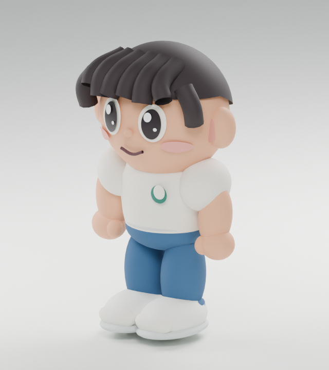
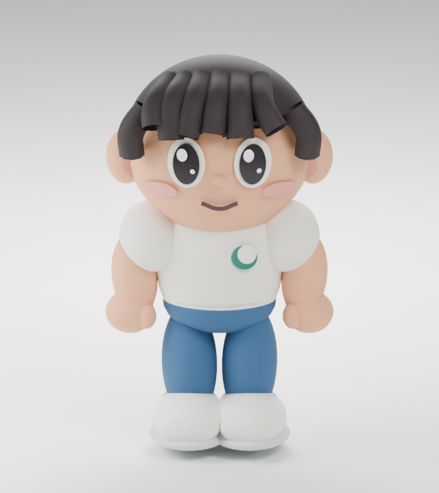
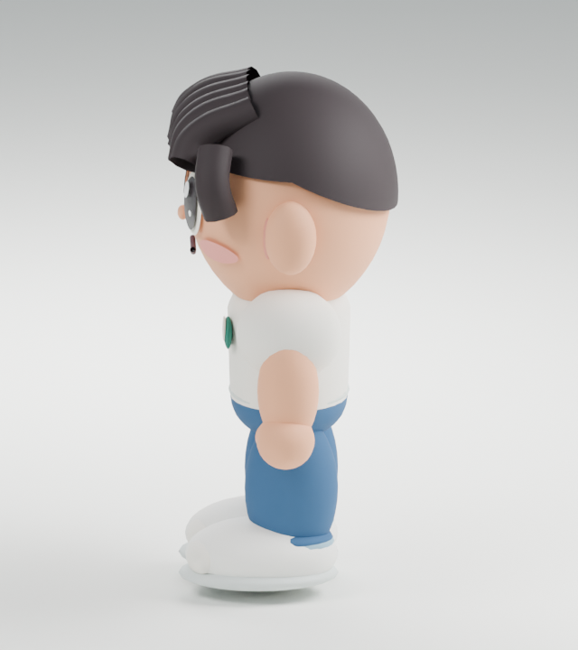
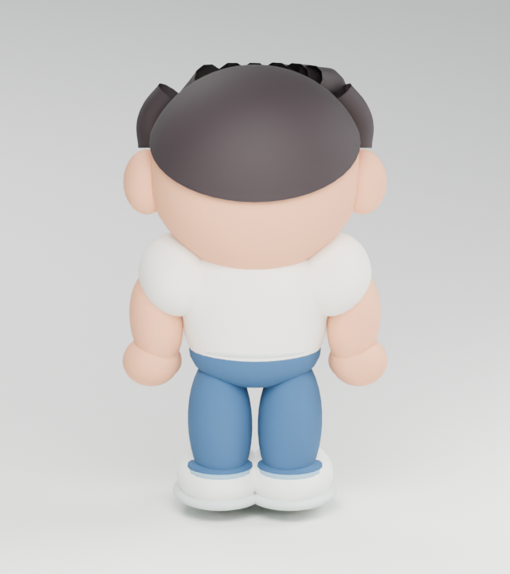

# GJH Chibi Visitor v2 · Casual Male (static character)

Original procedurally authored Blender **Chibi** visitor concept, for the Singapore/Malaysia virtual mall asset library. Visual comparison to the preceding `chibi-visitor-demo` is intended; the previous version remains unchanged.



## Visual specification

- Concept: stylized ~18-year-old male mall visitor, big soft-cheeked head, expressive smile, tidy blunt swept hair, white T-shirt, denim jeans, white sneakers.
- Metre-scale floor origin: measured ~1.804 m tall. Face points towards Blender **-Y**. Export uses glTF **+Y up**.
- Modules: `HEAD`, `HAIR`, `FACE`, `TOP`, `ARMS`, `JEANS`, `SHOES`, `ACCESSORY`; assets retain explicit transform groups for appearance swaps.
- Blender source has material-merged meshes within each module to keep draw calls bounded. The procedural generator recreates detailed part-level hair, face and clothing components prior to merging.
- Character **is static**: no armature, no skinned deformation, no Idle/Walk/Run animation, no interaction behavior. These must not be inferred from the gallery card.

## Studio views

| Front | Side | Back | 3/4 |
|---|---|---|---|
|  |  |  |  |

## Files

- `generate.py`: original Blender Python procedural authoring source; run only in a trusted environment.
- `chibi-visitor-v2.blend`: editable Blender source with module hierarchy and studio cameras.
- `exports/chibi-visitor-v2.glb`: published static geometry for Three.js / other glTF 2.0 consumers.
- `previews/front.webp`: lightweight Gallery thumbnail; four PNG renders are source-derived references.
- `metadata.json`: metrics, provenance, status, and verified feature limits.
- `qa/validate.mjs`, `qa/verify_blender.py`: repeatable glTF and Blender import QA.
- `qa/runtime-preview.html`: standalone local Three.js WebGL verification fixture, requiring `node_modules/three` to be served from the repository root.
- `unity/ChibiV2UnityQA.cs`: Unity 6 Editor script used for an actual import → UnityGLTF export round trip; copy to a local Unity project with UnityGLTF installed.

## Reproduce and verify

From the repository root (Blender 5.2.3 LTS):

```sh
blender -b --python models/chibi-visitor-v2/generate.py
npm ci
node models/chibi-visitor-v2/qa/validate.mjs
blender -b --python models/chibi-visitor-v2/qa/verify_blender.py -- models/chibi-visitor-v2/exports/chibi-visitor-v2.glb
```

The generator renders four camera views and replaces its own generated files; review its scope before use. For the Unity test, import `chibi-visitor-v2.glb` into `Assets/ChibiV2/` and run `ChibiV2UnityQA.Run` in an authorized Unity 6 project with Unity Personal and UnityGLTF 2.24.0. Unity's roundtrip GLB is a QA derivative, not the gallery production artifact.

## QA / known limits

See [QA report](qa/REPORT.md). The source and exported GLB are original creations; third-party character references and commercial model assets are not included. User art-direction approval remains pending. Public redistribution license has **not** been specified, so Gallery download is disabled.
