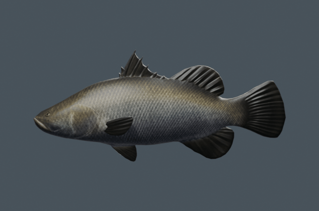
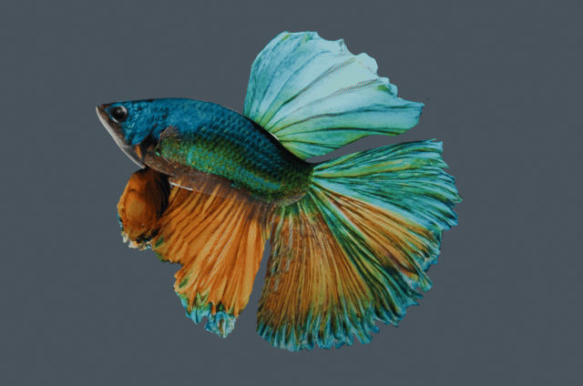
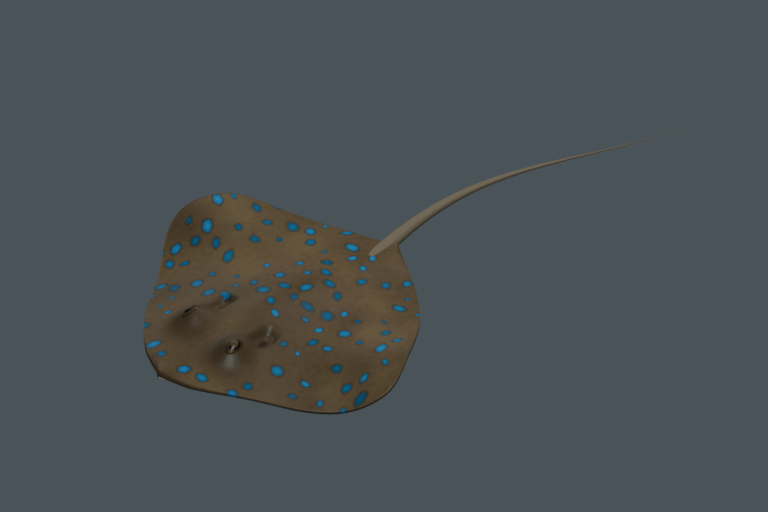

# Accepted fish realism models

The owner accepted the Barramundi and Betta revision-03 models and the stingray revision-04 model on 2026-11-15. This release preserves their editable Blender sources, animated GLBs, actual renders, license information and verification evidence. It does not replace gallery cards or any production GLB.

| Fish | Accepted files | Preview |
| --- | --- | --- |
| Barramundi | [revision 03](revision-03/barramundi/) |  |
| Betta | [revision 03](revision-03/betta/) |  |
| Stingray | [revision 04](revision-04/stingray/) |  |

See [acceptance.json](acceptance.json) for the exact approved set and file hashes. Earlier draft generator utilities are included only where needed for reproduction; rejected draft model binaries are omitted. Historical review text saying acceptance was pending is superseded by this acceptance record.

## Credits

Barramundi: Microsoft, distributed by the [Khronos glTF Sample Assets project](https://github.com/KhronosGroup/glTF-Sample-Assets/tree/main/Models/BarramundiFish), CC0 1.0. A swim skeleton and animation were added here.

Betta splendens: [BlueMesh](https://sketchfab.com/BlueMesh), [original model](https://sketchfab.com/3d-models/betta-splendens-f4eeb7f50ad24873842bd954ad27d23b), [CC BY 4.0](https://creativecommons.org/licenses/by/4.0/). The original swim clip is retained. Material response and presentation were changed; source provenance and the attributed redistribution revision are preserved under `external-candidates/betta/`.

Stingray: original project-authored mesh, textures and animation. Reference photographs are linked in the [revision-04 report](revision-04/README.md) and are not embedded in the textures.

## Verification

Revision 04 checks actual mesh deformation, front-to-rear wave timing and amplitude, an unmoving head probe, loop endpoint agreement, source-to-GLB probe agreement, packed images and preservation of all 60 production GLBs plus the 10 accepted Barramundi/Betta files. The Khronos validator reports zero errors and zero warnings for the stingray. No deployment or browser acceptance is claimed for these review GLBs.

The owner subsequently authorized independent sequential improvement of the remaining 57 fish through a photo, anatomy, materials, animation and export QA loop, with small-batch previews. That ongoing work is separate from this accepted release.
